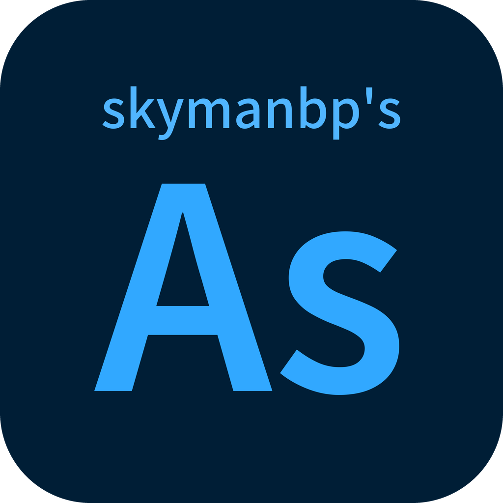
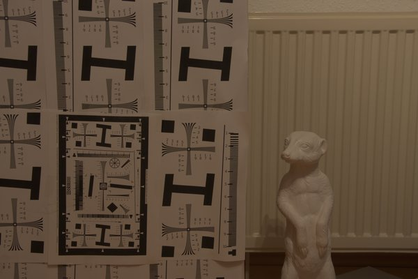
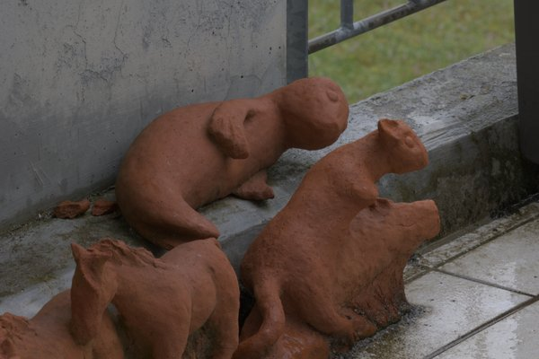
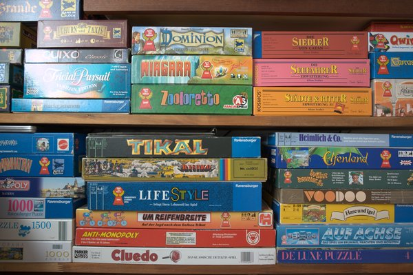
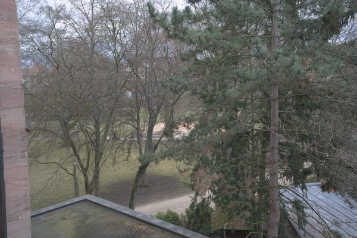
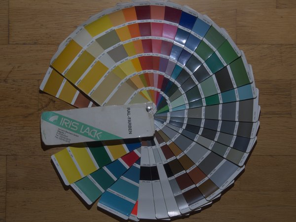
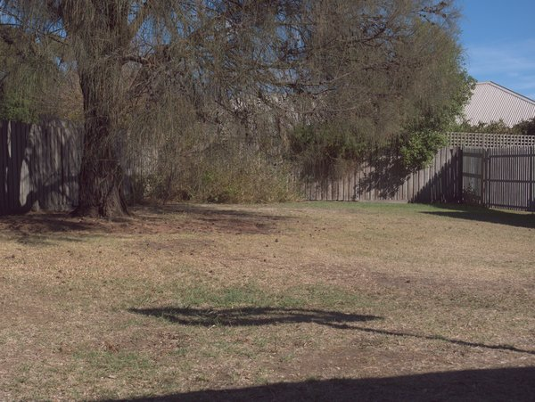
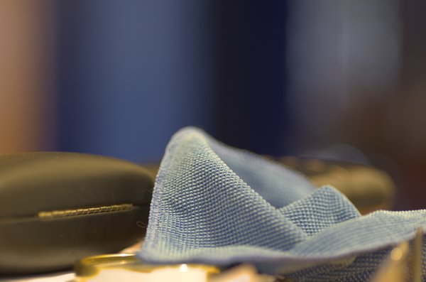
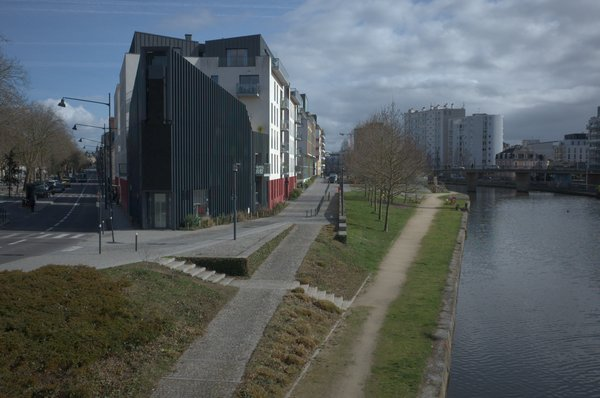
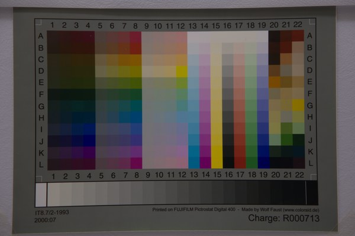

<div align="center">



# AutoShade

### Describe the picture. Keep the RAW.

AI decides *what* to change — a deterministic Rust engine *does* it.<br />
An editable, Lightroom-ready recipe instead of AI pixels.

<br />

[](https://github.com/skymanbp/autoshade/releases/tag/v1.15.0)
[](#install-and-quickstart)
[](rust-toolchain.toml)
[](LICENSE)

**[Download v1.15.0](https://github.com/skymanbp/autoshade/releases/tag/v1.15.0)**
&nbsp;·&nbsp; [Website](https://autoshade.dev/)
&nbsp;·&nbsp; [Manual](docs/USER_MANUAL.md)
&nbsp;·&nbsp; [Showcase](docs/SHOWCASE.md)
&nbsp;·&nbsp; [In depth](docs/DEEP_DIVE.md)

<br />


<sub>Straight conversion → generated target → <b>recovered recipe on the 61 MP RAW</b> → same recipe after AI denoise. Bottom row: 1:1 crops.</sub>

</div>

<br />

> [!TIP]
> **The generated picture is a target, never the delivery.** An image model paints the look you describe;
> AutoShade fits an editable develop recipe to it and renders that recipe on the full-resolution RAW.
> The recipe carries the look, the sensor carries the detail — and in the recipe path, **the AI never touches a pixel.**

**Two AI paths, kept apart in the app, the command line and this page:**

- **AI generation & reverse-fit** — an image model paints the picture you describe from your own frame (`reimagine`), and the reverse fit recovers that look as an editable recipe on the full RAW (`match`). The generated pixels are only ever a target.
- **AI analysis & auto develop** — a vision model looks at the photo and proposes the recipe directly (`analyze`, `auto`), guided by your reference library or a typed direction; **AI adjust** sends the develop you are looking at with a request ("darken the sky a little") and gets the complete adjusted recipe back, with any part it names selected by a content mask cut locally.

<br />

## Highlights

<table>
<tr>
<td width="50%" valign="top">

**🎯 Reverse-fit any look**<br />
<sub>`reimagine` generates the picture from your frame; `match` recovers a recipe from it — or from any finished rendition of the same shot. Look error **0.161 → 0.023**.</sub>

</td>
<td width="50%" valign="top">

**🌌 A RAW denoiser trained here**<br />
<sub>Cleans the sensor mosaic before demosaic. Keeps **98.70 %** of 17,817 faint stars against Lightroom Denoise's 98.80 %.</sub>

</td>
</tr>
<tr>
<td valign="top">

**📐 Lightroom parity, measured**<br />
<sub>Texture **45 / 45** anchors within ±0.02, radial masks **41 / 41** within 1 px. Every residual is published.</sub>

</td>
<td valign="top">

**🔁 Round-trips through Lightroom**<br />
<sub>Sidecar XMP is merged byte for byte; the full develop survives a Lightroom rewrite and reopens exactly.</sub>

</td>
</tr>
<tr>
<td valign="top">

**🖼️ Your library is the style guide**<br />
<sub>Point it at finished photos you love; each develop sees the 3 closest as a reference. Embeddings run locally.</sub>

</td>
<td valign="top">

**🧩 Local AI masks, no API key**<br />
<sub>Subject, sky and point-prompted objects (BiRefNet, OneFormer, SAM 2.1), plus HDR, focus and noise stacking.</sub>

</td>
</tr>
</table>

## Showcase


<sub><b>Reverse-fit.</b> Prompt: <i>“a clearer afternoon, a little more contrast, a slightly deeper blue sky.”</i> The recipe renders the look on the 9504 × 6336 RAW; the generated frame carries neither the detail nor the resolution.</sub>

<br />


<sub><b>One RAW, four looks.</b> Straight conversion, then <i>moody</i>, <i>golden</i> and <i>vivid</i> — only the direction text changes.</sub>

<br />


<sub><b>ISO 2500 star field, 1:1.</b> Top: Lightroom, Denoise off / 50. Bottom: AutoShade, off / its own denoiser at 71 %. Clean colour, natural grain, faint stars intact.</sub>

<p align="right"><sub>Every number and prompt → <a href="docs/SHOWCASE.md">Showcase</a></sub></p>

## What is new here

Six techniques you will not find in another RAW developer. Each is written up in full — equations, figures, refused training runs — in **[AutoShade in depth](docs/DEEP_DIVE.md)**.

| | Technique | In one line |
|:-:|---|---|
| **1** | [Generate, then reverse-fit](docs/DEEP_DIVE.md#1-whole-image-ai-generation-then-reverse-fit-an-editable-recipe-from-any-finished-look) | An editable recipe from any finished look, solved at the distribution level |
| **2** | [Evidence-gated local fit](docs/DEEP_DIVE.md#2-how-the-reverse-fit-decides-divergence-evidence-gates-and-a-priced-local-field) | A divergence score `D` picks full solve or bounded mode; every local move must earn its place |
| **3** | [Style by retrieval](docs/DEEP_DIVE.md#3-style-reference-is-retrieval-over-your-whole-catalogue-not-a-preset) | SigLIP 2 search over your own finished photos, not a preset |
| **4** | [Measured Lightroom parity](docs/DEEP_DIVE.md#4-lightroom-parity-is-measured-and-the-residuals-are-published) | Tone, Texture, Sharpening, masks and lens geometry fitted to Lightroom exports |
| **5** | [A denoiser with pre-written pass marks](docs/DEEP_DIVE.md#5-the-raw-denoiser-is-trained-here-and-judged-by-pass-marks-written-before-the-run) | Trained on this project's data; two later runs failed their marks and were refused |
| **6** | [The camera's own look](docs/DEEP_DIVE.md#6-the-cameras-own-look-is-read-from-the-picture-like-with-like) | A per-photo base curve read from the embedded preview, like with like |

## How it works

<picture>
  <source media="(prefers-color-scheme: dark)" srcset="docs/images/architecture-dark.svg" />
  
</picture>

- **One engine, three front ends** — desktop app, CLI and loopback web UI share one Rust library and one per-user develop store.
- **Local first** — eight Python sidecars (masks, two denoisers, correspondence, descriptions, embeddings, depth for the lens blur, faces) run on your machine; pixels leave it only for an AI operation you ask for.
- **Non-destructive** — your photo library stays read-only; generated pixels always land on their own labelled card.

<sub>Diagram generated from [autoshade.architecture.json](docs/architecture/autoshade.architecture.json) · [zoom it online](https://autoshade.dev/architecture.html) · full design in [ARCHITECTURE.md](docs/ARCHITECTURE.md)</sub>

## Measured numbers

| What | Measured |
|---|---|
| Automated test battery | 1754 library / 25 CLI / 292 GUI / 2+2 contract tests |
| RAW coverage | 24 extensions · 725 camera bodies · nine-camera zoo 9/9 |
| Reverse-fit, stone viaduct | look error 0.161 → 0.023 at confidence 0.63 |
| Reverse-fit, desert canyon | look error 0.129 → 0.048 · sky ΔE 3.8 |
| Faint stars kept, vs Lightroom Denoise 50 | 98.70 % vs 98.80 % of 17,817 stars |
| Lightroom Sharpening fit | per-pixel R² 0.93 (0.62 for plain unsharp mask) |
| Brush geometry vs Lightroom | error 874 px → 9.8 px |

<sub>The full table — 20+ rows with conditions and sources — is in [AutoShade in depth](docs/DEEP_DIVE.md#measured-numbers); [`scripts/check_docs.py`](scripts/check_docs.py) re-derives the pinned claims.</sub>

## Install and quickstart

| Platform | Get it |
|---|---|
| **Windows** | `AutoShade-Setup-1.15.0.exe` — per-user, no admin. Or the portable `autoshade-1.15.0-windows-x64.zip` |
| **macOS** | `AutoShade-1.15.0-macos-universal.zip` (Apple silicon + Intel), or `-macos-cli.zip` |
| **Linux** | `AutoShade-1.15.0-linux-x64.zip` — command line only |

All on the **[v1.15.0 release page](https://github.com/skymanbp/autoshade/releases/tag/v1.15.0)**. Python 3 is needed only for the local AI sidecars; model weights download on first use.

> [!NOTE]
> **macOS:** the app is ad-hoc signed, not notarised — on first launch use **System Settings → Privacy & Security → Open Anyway** (once per machine).

**Desktop app** — it starts on a mode page (Landscape, Portraits, Normal; see [Choosing a mode](docs/USER_MANUAL.md#choosing-a-mode)); then open a photo (`Ctrl+O`), move a slider, export with `Ctrl+Shift+E`. The original is never touched. **Normal** is a short one-click panel for phone and jpg photos ([Normal mode](docs/USER_MANUAL.md#normal-mode)).

**CLI**

```bash
# manual develop
autoshade apply photo.ARW recipe.json -o developed.tif

# AI develop, end to end
autoshade auto photo.ARW --guidance "natural color; protect highlights" -o developed.tif

# describe a look, then recover it as an editable recipe on the RAW
autoshade reimagine photo.ARW --prompt "a clearer afternoon, deeper blue sky"
autoshade match photo.ARW out/photo.reimagine.png --render
```

Upgrades, silent installs and every command: **[User manual](docs/USER_MANUAL.md)**.

<details>
<summary><b>Release assets and checksums</b></summary>

<br />

Built by GitHub Actions from the tag; `checksums.txt` carries every SHA-256. The RAW denoiser weights are uploaded by hand to the release the sidecar pins —
[`releases/download/v1.6.0/autoshade-raw-denoise-v2.pth`](https://github.com/skymanbp/autoshade/releases/download/v1.6.0/autoshade-raw-denoise-v2.pth),
mirrored byte-exact on [Hugging Face](https://huggingface.co/Azng0/autoshade-mirror-autoshade-raw-denoise) — and refused unless size and SHA-256 match the pin in `python/denoise_raw.py`.

| File | Size | SHA-256 |
|---|---:|---|
| `autoshade.exe` (CLI) | 23,352,320 bytes | `88c72d1b360b4180b87a820794b78c625236125d9c11cc5e20669c44b1369029` |
| `autoshade-gui.exe` (desktop app) | 30,610,432 bytes | `0c12450860facf8c5cd41fda43b0c3959b5f84e1b89e8b044b5da33cfb3406a9` |
| `AutoShade-Setup-1.15.0.exe` (installer) | 15,556,774 bytes | `0d0e22b1dc29048ba216018cc20fd32cbf546e532ff3b357c53665e4891d1f8b` |
| `autoshade-1.15.0-windows-x64.zip` (portable archive) | 21,100,005 bytes | `8135388fedcf629a2d731ffa87e0a73399446e641d8698f2a91bc11b7e83c628` |
| `AutoShade-1.15.0-macos-universal.zip` (macOS app bundle) | 42,446,034 bytes | `daf9f5bf1d5b153bac9e48598cc23804cb8539180240d715e5d74877602ef597` |
| `AutoShade-1.15.0-linux-x64.zip` (Linux command line only) | 10,131,381 bytes | `44051b591ee0e8a63a5572088860118aae0412231208439aeb0345edb164f924` |
| `AutoShade-1.15.0-macos-cli.zip` (macOS command line only) | 18,320,088 bytes | `382b31a2d67b2c607879ad00c03d984d0f1032c4f6f95c5643e921689a5affc3` |
| `autoshade-raw-denoise-v2.pth` (RAW denoiser weights, fetched on demand from the v1.6.0 release) | 130,590,559 bytes | `ffafa40a53f52092149db2fcf03636117ad6855e1068142d4f6b03b634e9f9c4` |

</details>

<details>
<summary><b>Build from source</b></summary>

<br />

Rust edition 2024, rustc/cargo 1.94.

```bash
cargo build --release                                   # CLI
cargo build --release --features gui --bin autoshade-gui  # desktop app
```

Local AI tools need Python packages (weights download on first use):

| Tool | Packages |
|---|---|
| Subject mask (BiRefNet) | `torchvision timm einops` |
| Subject fallback (U²-Net) | `rembg` |
| Sky / objects (OneFormer, SAM 2.1) | `transformers torch` |
| AI denoise | `torch opencv-python numpy einops requests` |

</details>

## Supported formats

<div align="center">

<table>
<tr>
<td align="center"><br /><sub><b>.cr2</b> · Canon EOS 40D</sub></td>
<td align="center"><br /><sub><b>.cr3</b> · Canon EOS R6</sub></td>
<td align="center"><br /><sub><b>.nef</b> · Nikon D700</sub></td>
</tr>
<tr>
<td align="center"><br /><sub><b>.arw</b> · Sony α7 III</sub></td>
<td align="center"><br /><sub><b>.orf</b> · Olympus E-M5</sub></td>
<td align="center"><br /><sub><b>.rw2</b> · Panasonic DMC-GX85</sub></td>
</tr>
<tr>
<td align="center"><br /><sub><b>.pef</b> · Pentax K-5</sub></td>
<td align="center"><br /><sub><b>.dng</b> · Ricoh GR II</sub></td>
<td align="center"><br /><sub><b>.raf</b> · Fujifilm X-S10 — X-Trans, approximate</sub></td>
</tr>
</table>

<sub>Nine real CC0 files, fully decoded and neutral-rendered — not embedded previews.</sub>

</div>

**Camera RAW — 24 extensions**

```text
arw, dng, raw, raf, nef, cr2, cr3, orf, rw2, pef, srw, 3fr,
fff, iiq, mef, mos, erf, kdc, dcr, dcs, crw, nrw, mrw, ari
```

Decoded by rawler 0.7.2, which carries **725 camera models**. **No embedded
preview:** 12 of the 24 formats store none. They are `orf`, `srw`, `nrw`, `mef`,
`mos`, `kdc`, `dcr`, `dcs`, `erf`, `iiq`, `crw`, and `ari`; AutoShade renders its own neutral version instead.

**Baked rasters — 8 extensions:** `jpg` `jpeg` `png` `tif` `tiff` `bmp` `webp` `gif`, with ICC conversion.

## Tech stack

**Rust** (rustc/cargo 1.94, edition 2024) · rawler · image · qcms · rayon · egui/eframe · tiny_http — **Python** sidecars on PyTorch.

RAW decode, 24 formats, 725 bodies · deterministic f32 develop engine · hand-rolled XMP layer (no XML crate) for byte-exact Lightroom merges.
The current battery is **1754 library (1739 pass + 15 `#[ignore]`d forensic probes) / 25 CLI / 292 GUI / 2+2 contract** tests.
Per-subsystem notes: [In depth → Implementation](docs/DEEP_DIVE.md#implementation) · equations and provenance: [TECH_STACK.md](docs/TECH_STACK.md).

## Status and limitations

- **Release gates at v1.15.0** cover the CLI, desktop GUI, sidecar contracts, format fixtures and the deterministic renderer.
- **Not in scope:** bit-exact Adobe rendering (parity is measured, not identical), an exact X-Trans demosaic, a notarised macOS build, a Linux desktop app.
- **Honest markers:** AI masks are local re-creations, not Adobe's pixels; linear masks are not pixel-closed (radial closes 41/41 to ≤ 1 px); the macOS app is CI-verified but has no reported interactive users yet.
- Release ledger and rulings: [ROADMAP.md](docs/ROADMAP.md).

## License

**MIT** — see [LICENSE](LICENSE). Showcase photographs © 2026 skymanbp, all rights reserved (not MIT).

<details>
<summary><b>Models, fonts and samples</b></summary>

<br />

Model weights download separately and remain their authors' property; every pinned model also has a byte-exact mirror on Hugging Face (`Azng0/autoshade-mirror-*`), checksum-verified either way — table in [`python/_mirror.py`](python/_mirror.py).

| Model | Purpose | License |
|---|---|---|
| SCUNet | AI denoise (baked sources) | Apache-2.0 |
| DRUNet-colour (DPIR), fine-tuned here as `autoshade-raw-denoise-v2.pth` | AI denoise (RAW mosaic) | MIT; fine-tuning pairs from RawNIND, CC BY-SA 4.0 |
| BiRefNet | Subject segmentation | MIT |
| U²-Net | Subject fallback | Apache-2.0 |
| OneFormer ADE20K | Sky segmentation | MIT |
| SAM 2.1 | Point-prompted object masks | Apache-2.0 |
| MoGe-2 ViT-L (code in `python/_moge/`) | AI lens blur depth map | MIT (DINOv2 backbone code Apache-2.0) |
| MediaPipe Face Landmarker (BlazeFace + Face Mesh V2) | Portraits mode face and eye outlines | Apache-2.0 |
| SigLIP 2 | Style embeddings | Apache-2.0 |
| Qwen3-VL-2B-Instruct | Local look descriptions | Apache-2.0 |
| Stable Diffusion 2.1 | DIFT correspondence field | CreativeML Open RAIL++-M |

**Fonts:** subset Noto faces (SIL OFL) and a Lucide icon face (ISC) — texts in `assets/fonts/`.
**RAW samples:** the nine format-grid files are from [raw.pixls.us](https://raw.pixls.us/) under CC0 1.0, SHA-256-verified.

Thanks to the rawler, image, qcms, rayon, clap, serde, ureq, egui/eframe, tiny_http and local-model communities.

</details>

<br />

<div align="center">
<sub>Made for photographers who want to know <i>what</i> the AI changed — in numbers.</sub>
</div>
