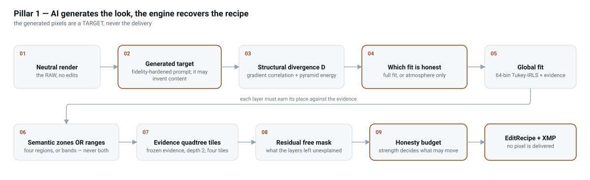
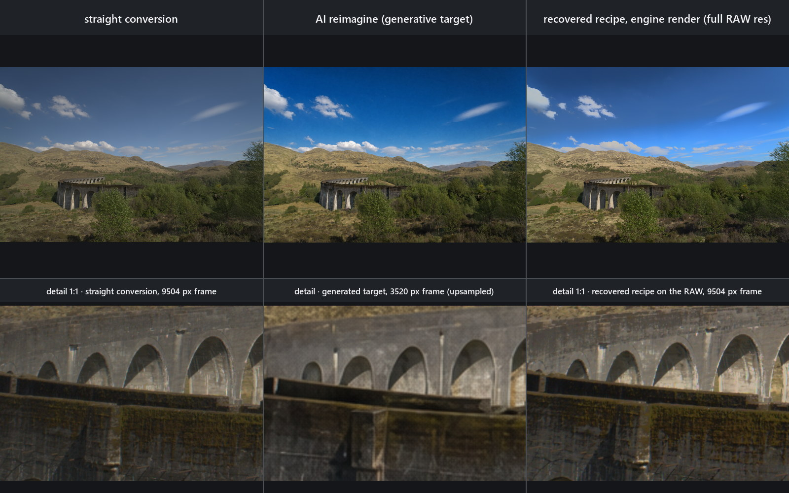
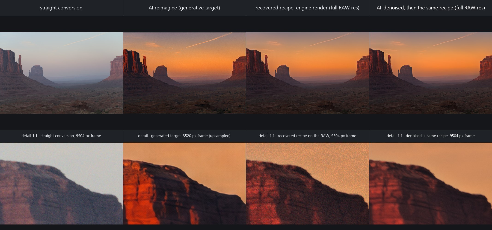
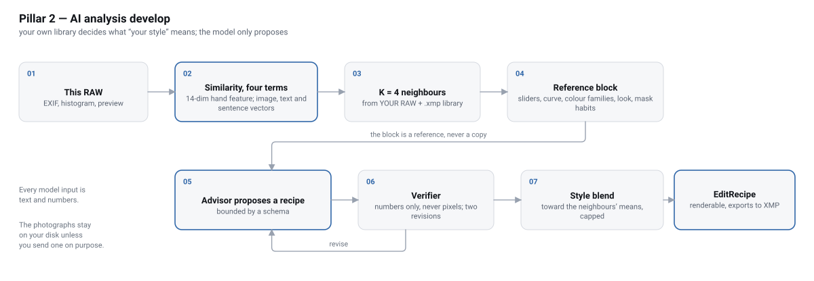
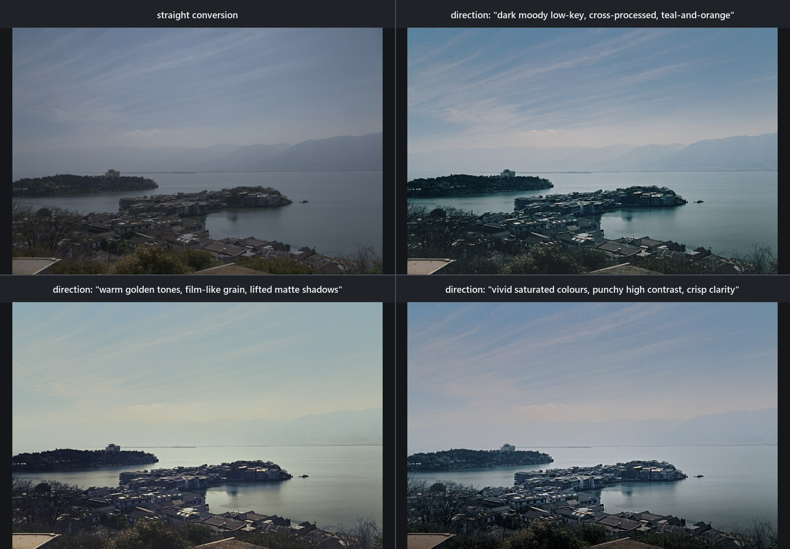
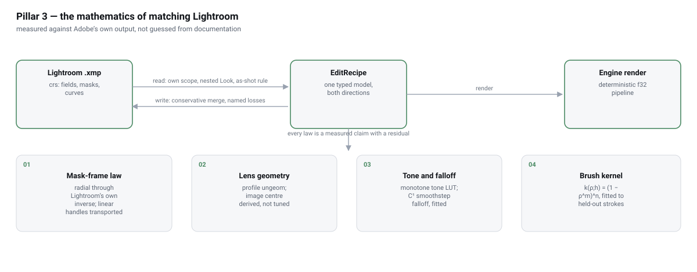
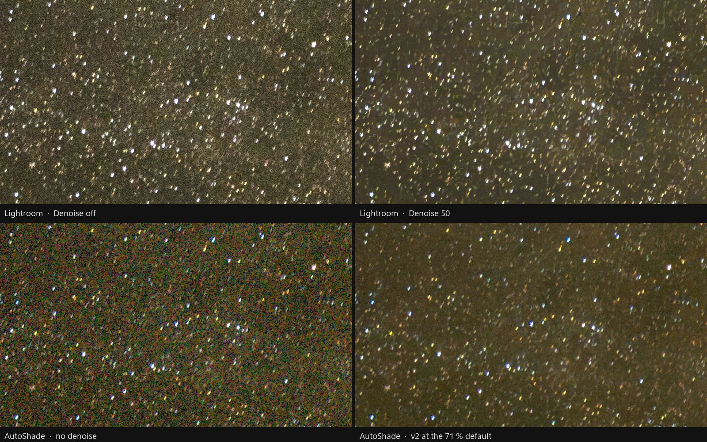
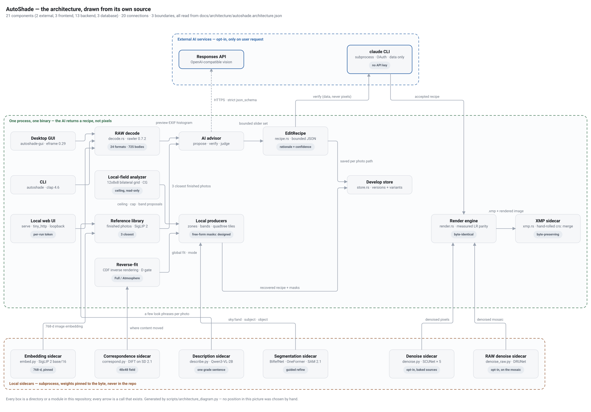

# AutoShade in depth

The long-form companion to the [README](../README.md): the six techniques in
full, every measured number with its source, and the implementation notes per
subsystem. The equations and provenance behind each line are in
[TECH_STACK.md](TECH_STACK.md); the system design is in
[ARCHITECTURE.md](ARCHITECTURE.md).

## Contents

- [1. Whole-image AI generation, then reverse-fit](#1-whole-image-ai-generation-then-reverse-fit-an-editable-recipe-from-any-finished-look)
- [2. How the reverse-fit decides](#2-how-the-reverse-fit-decides-divergence-evidence-gates-and-a-priced-local-field)
- [3. Style reference is retrieval](#3-style-reference-is-retrieval-over-your-whole-catalogue-not-a-preset)
- [4. Lightroom parity is measured](#4-lightroom-parity-is-measured-and-the-residuals-are-published)
- [5. The RAW denoiser](#5-the-raw-denoiser-is-trained-here-and-judged-by-pass-marks-written-before-the-run)
- [6. The camera's own look](#6-the-cameras-own-look-is-read-from-the-picture-like-with-like)
- [Designed, not yet shipped](#designed-not-yet-shipped)
- [How it works](#how-it-works)
- [Measured numbers](#measured-numbers)
- [Design philosophy](#design-philosophy) · [Implementation](#implementation)

## 1. Whole-image AI generation, then reverse-fit: an editable recipe from any finished look

<picture>
  <source media="(prefers-color-scheme: dark)" srcset="images/pillar-reimagine-fit-dark.svg" />
  
</picture>

Zoom and pan this diagram at [autoshade.dev/#pillar-reimagine-fit](https://autoshade.dev/#pillar-reimagine-fit).

Ask for the picture in words. `reimagine` sends the frame and the prompt to
an image model and gets back a complete picture that may have invented
content; `match` then recovers, from that picture, a recipe the engine can
render on the full-resolution RAW — global tone and colour first, then
zones, bands, tiles and a smooth colour field, each admitted only on
evidence. The recipe carries the look and the sensor carries the detail;
the generated picture is a target, never the delivery. The two pairs
below are the whole path, and every number in their captions is measured;
a third pair, a Cornwall lighthouse islet, is on
[docs/SHOWCASE.md](SHOWCASE.md).

The source frame is one function for both entry points: a neutral develop of
the RAW at a 2048 px working edge, never the camera's embedded JPEG preview.
That matters because the two read differently — on the desert pair below, the
embedded rendition measured D = 0.361 and bought the bounded atmosphere path,
while the neutral develop of the same sensor frame reads D = 0.278 and
earns the full solve. The pair is read at TWO scales and both are printed:
D = 0.278 per pixel and 0.658 per layout on that frame, so a report says
whether the solve paired source pixel with target pixel or only their
statistics. The coarse reading is a second scale, not a more forgiving one —
measured, it reads HIGHER at frame, zone and cell scope, because the luma is
rank-equalised against each image's own histogram and removing the shared
fine texture leaves exactly the regional luma a repaint moved.

<b>Stone viaduct.</b> Top row: the straight conversion, a 3520×2352
<code>gpt-image-2</code> target asked for <i>a clearer afternoon, a little more
contrast, a slightly deeper blue sky, everything else unchanged</i>
(<b>D = 0.180</b>, under the 0.35 threshold, so the full solve ran), and the
recovered recipe rendered on the 9504×6336 RAW at Reverse-fit strength 100 %
(the product default is 65 %): look error <b>0.161 → 0.023</b> at confidence
0.63. Bottom row: the same window of the frame at each source's native
resolution — the recipe carries the look, the RAW carries the detail, and the
generated frame carries neither at full size. Every control the fit set, the
default-strength fit and the seam measurement are in
[docs/SHOWCASE.md](SHOWCASE.md).

<b>Desert canyon at dusk.</b> The desert pair from the paragraph
above — the reference pair every release is gated on — and the hardest of
the three: the target is a full regeneration, not a grade, so the sky's
texture is re-synthesised and only its layout survives (<b>D = 0.278</b>
at pixel scale, 0.658 at layout scale). Top row: the straight conversion,
the 3520×2336 <code>reimagine</code> target, the recipe the v1.6.1 release
gate itself recovered at Reverse-fit strength 85 % rendered on the
9504×6336 RAW — look error <b>0.129 → 0.048</b>, and against the target
sky ΔE <b>3.8</b> with whole-frame mean |diff| <b>0.0248</b> — and the same
recipe rendered after the RAW denoiser of [§5](#5-the-raw-denoiser-is-trained-here-and-judged-by-pass-marks-written-before-the-run) cleaned the
sensor mosaic first, at its 71 % default: sky ΔE 3.5, mean |diff| 0.0238,
the look unchanged. Bottom row: the same window at each source's native
resolution; between the last two crops only the denoiser differs, and the
fine grain in the window (the spread of a 2-px high-pass) falls from 3.1
to 0.6 codes. What the fit does not reach is disclosed rather than measured
away: the land stays at ΔE 6.0, and the warm haze on the far mesas is the
known gap. Every control and every number in
[docs/SHOWCASE.md](SHOWCASE.md).

`match` recovers an editable recipe from any finished rendition of the same
frame ([`src/fit.rs`](../src/fit.rs)). A generated target is not pixel-aligned
with its source, so the solve is **distribution-level, not per-pixel
regression**:

- Luminance CDFs are matched at the engine's own tone knots and least-squares
  solved against its own slider basis under a ridge and a model-selection
  prior; saturation closes by mean-chroma ratio.
- The per-channel CDF residual becomes RGB curves admitted only through four
  vetoes and a projection: one refuses a cast painting a hue more than 45°
  from every target family over ≥ 5 % of the frame, and the fourth (v1.2.3)
  refuses curves that fan a single-hued class by ≥ 15° across luminance.
- Residual tone-curve knots sit uniformly in the LUT's *output* domain, which
  keeps a steep camera base curve from sagging the chords by ~10/255.

Details: [docs/TECH_STACK.md#ai-advisor-and-reverse-fit](TECH_STACK.md#ai-advisor-and-reverse-fit).

## 2. How the reverse-fit decides: divergence, evidence gates and a priced local field

Every local move is admitted on evidence, budgeted at its seams and priced
against a ceiling before it ships; the equations and the calibration numbers
are in [docs/TECH_STACK.md#ai-advisor-and-reverse-fit](TECH_STACK.md#ai-advisor-and-reverse-fit).

- **A structural reading `D`** (gradient correlation and a five-band pyramid
  energy error) says whether the target still shows the same scene: same
  scene → the full solve; repainted (`D ≥ 0.35`) → a bounded **Atmosphere**
  mode (EV ±1, WB gain [0.80, 1.25], saturation ±30, curve slope [0.5, 1.5],
  confidence capped at 0.50, no per-channel curves). At the shipped Strength
  0.65 the global controls, WB included, are byte-identical to the
  calibrated path's; above it an out-of-budget white balance is shrunk along
  its fitted log-K/linear-tint manifold and must clear the foreign-hue veto
  and a rotation budget (0.05 at default, 0.593 at 0.85, 1.0 at full) or it
  is withheld ([docs/TECH_STACK.md#reverse-fit-freedom-budget](TECH_STACK.md#reverse-fit-freedom-budget)).
- **Where the content moved**, a DIFT correspondence field (Stable Diffusion
  2.1's UNet as a featurizer, `t = 261`, 768² inputs, an 8-draw ensemble, a
  48×48 grid) weights a zone's pixel pairs; its confidence is cyclic
  consistency × flow smoothness, so a pixel-shuffle of the same frame stays
  unmatchable (an identity pair reads 1.000 at 100 % coverage, the
  calibration pair's generated sky 0.009 at 21.5 %).
- **Semantic zones, luminance bands and colour bands** come from mutually
  exclusive producers — a local OneFormer ADE20K pass (sky/land, up to four
  class regions opt-in), or with segmentation off XMP-native luminance-range
  bands from rank-paired residuals and colour-range bands keyed to the eight
  ACR hue bands, each refused without evidence on both sides of the edit —
  and every verdict follows the population a correction moves. Sky and land
  ride out to Lightroom as its own Select Sky mask (`crs:What="Mask/Image"`,
  `crs:MaskSubType="2"`); four-class regions, tiles and field masks remain
  raster masks with the named bitmap loss
  ([docs/TECH_STACK.md#zone-scoped-evidence-view](TECH_STACK.md#zone-scoped-evidence-view)).
- **Seams are budgeted per crossing**: no larger than what the scene itself
  carries there, floored at one code value, capped at the calibrated 0.012,
  charged only on what the paired target does not itself carry, in luma and
  in each colour channel; a feather too smooth to hide anything is widened
  first (a ramp up to 6 % of the frame height), and both the widening and
  its abstention are disclosed.
- **Tiles split on frozen evidence**, a quadtree stopping at a 4×4 grid: a
  tile is kept only when both frames contribute ≥ 3 % evidence, structure
  stays comparable, its confidence interval excludes zero, its boundary
  clears the rim ceiling and the composed frame does not regress; hard tiles
  are intersections of four gradients and export to Lightroom, and a
  free-form remainder pass has refused every proposal on the calibration
  corpus ([docs/TECH_STACK.md#layered-spatial-reverse-fit-and-mask-refinement](TECH_STACK.md#layered-spatial-reverse-fit-and-mask-refinement)).
- **A bilateral-grid local field prices every producer first**: a read-only
  12×32×8 grid (x, y, luma; the 12×8 evidence cells with every row refined
  four times) of five develop parameters solved by conjugate gradients in
  f64 (a Tikhonov term and a Laplacian smoother calibrated at 12×8×8,
  ≤ 90 iterations),
  whose residual is the **ceiling** any spatially varying develop could
  reach — the calibration pair's reading is under
  [Measured numbers](#measured-numbers), and the Rust solve agrees with the
  NumPy reference across all 3072 vertices. It never touches a
  pixel: it proposes bands, halves the tile budget when the remainder is not
  tile-shaped, and ends the fit within 0.002 of a ceiling that beat the
  producer-free frame ([docs/TECH_STACK.md#local-field-analyzer](TECH_STACK.md#local-field-analyzer)).
- **Masks earn their refinement** (guided, radius 8): the original bytes win
  unless coverage is conserved, pixels outside the collar are unchanged,
  guide-edge alignment does not fall and the gates still pass; the AI masks
  run locally with weights pinned to the byte and every alpha cached under a
  provenance key.
- **Generated pixels are quarantined**: `reimagine` composes the prompt onto
  a faithfulness scaffold (`input_fidelity` is silently dropped by
  gpt-image-2), measures the result with the same `D` and can spend one
  bounded retry; every paid generation lands as a new ✨ card except a GUI
  fill or AI edit, which lands as a layer you can switch off; `heal` only
  copies, shifts and averages existing pixels; Lightroom spot removal is
  re-solved from the photograph's own pixels with the synthesised areas
  named; an HDR-mode edit renders as Lightroom's own SDR rendition.

## 3. Style reference is retrieval over your whole catalogue, not a preset

<picture>
  <source media="(prefers-color-scheme: dark)" srcset="images/pillar-analysis-dark.svg" />
  
</picture>

Zoom and pan this diagram at [autoshade.dev/#pillar-analysis](https://autoshade.dev/#pillar-analysis).

<b>One photograph, four looks.</b> The straight conversion of a hazy
lakeside frame and three AI develops of the same RAW at the same
<code>--style 1.0 --strength 0.9</code> against the photographer's full
index — 169 Lightroom RAW+XMP edits and a 94-photo finished-look library —
where only the <b>direction text</b> changes. Since v1.2.3 a written
direction leads and those edits become background: mean saturation
28 % / 11 % / 30 % for moody / golden / vivid against the conversion's
17 %, mean brightness 43 % / 58 % / 70 % against 47 %. Judge trails,
prompts, the v1.2.2 comparison and the finished-look-only run in
[docs/SHOWCASE.md](SHOWCASE.md); model-judge scores are automated
review, not human aesthetic approval.

`autoshade library-build <dir>` turns a folder of finished photos whose look
you like into a reference library ([`src/library.rs`](../src/library.rs)); each
develop is shown the **3 closest** as a soft reference.

- An entry is measured from its pixels only — no `.xmp` is read, so exports
  that went through other editors count as they look: a 768-dimensional
  **SigLIP 2** image vector and, with `--describe`, a few short **Qwen3-VL-2B**
  phrases about the *grade* ("warm, faded, low contrast"). Nothing leaves the
  machine, and a rebuild measures only new or changed photos.
- An analysis follows EITHER your library OR your typed Direction — a switch
  picks one. Guided by the library, it picks the photos whose scene is closest
  to this one (versions of one shot count once) and sends no Direction.
- The references reach the model as words and, if you opt in, as pictures;
  nothing is blended into the recipe.
- Optionally name your RAW folder: when a finished photo's RAW sidecar,
  developed here, looks like the finished photo, its settings go with that
  reference; a sidecar that develops to a different picture is ignored.

Details: [docs/TECH_STACK.md#ai-advisor-and-reverse-fit](TECH_STACK.md#ai-advisor-and-reverse-fit).

## 4. Lightroom parity is measured, and the residuals are published

<picture>
  <source media="(prefers-color-scheme: dark)" srcset="images/pillar-lightroom-math-dark.svg" />
  
</picture>

Zoom and pan this diagram at [autoshade.dev/#pillar-lightroom-math](https://autoshade.dev/#pillar-lightroom-math).

The tone LUT, the two-arm Texture model (`A1 = 0.172443`, `A2 = 0.304888`;
45 of 45 Lightroom anchors within ±0.02), the 290×11 radial feather LUT,
the brush law `(1 − ρ^m)^n` with the measured flow constant `κ = 0.1284`
(D1 error 874 px → 9.8 px), and the lens mask-frame transport built from
Sony's own 16 native samples (radial 41/41 vectors within 1 px; linear
openly *not* pixel-closed, RMS 9.748/7.025/6.336 px) were each fitted to
Lightroom output. The XMP layer is hand-rolled on purpose — no XML crate —
so a catalogue sidecar is merged into byte for byte, down to the SVD fold
between Lightroom's pixel-space radial tilt and the engine's normalised
rotation and to its `tiff:Orientation`, rewritten only when the
photographer's own turn has moved away from it; Lightroom's Brotli-packed
brush dab streams are imported and verified (`MD5 → .acr → Brotli`). Two of
those fits were re-measured in v1.2.4 against Lightroom's own coverage on a
46-export pack: the linear falloff moved onto the abscissa `t^1.124`
(α rms 0.0293 → 0.0074), and the radial boundary is a pure 0.99876 scale of
the stored ellipse — no dilation law.

Since v1.6.5 the Sharpening slider is measured too: one 61 MP star-field
frame exported from Lightroom at Sharpness 0 / 40 / 80 (Radius 1.0, Detail
25, Masking 0), and the operator's gains, its shadow rolloff and its two
halo limits fitted per pixel to what moved between the exports — R² 0.93 at
40 and 0.92 at 80 over the frame, 0.95 on the edges and stars one actually
sees, where the plain unsharp mask it replaced explained 0.62. Lightroom's
dark ring around a bright star turned out to be bounded by the pixel's own
luminance rather than by one constant, so the ring digs with the star:
0.02 / 0.04 / 0.07 for faint / mid / bright stars against Lightroom's
0.02 / 0.04 / 0.08. Masking and the rest of Detail's band are unmeasured.
Details:
[docs/TECH_STACK.md#develop-pipeline-and-tone-model](TECH_STACK.md#develop-pipeline-and-tone-model).

## 5. The RAW denoiser is trained here and judged by pass marks written before the run

The author's own ISO 2500 star field, one 796 × 462 px window at 1:1,
shown one stop brighter than the develops (the same gain on all four panels).
Top: Lightroom's own develop with Denoise off and at 50. Bottom: AutoShade's
neutral develop with no denoise and with its denoiser at the 71 % default —
clean colour, the frame's own luminance grain, the faint stars still there.
These are the four files the star-field test below measures.

Four training runs were made for this denoiser, on this project's own data.
The first two shipped; the last two were refused by pass marks written down
before they started, and one of them ran as five parallel jobs on a rented
cloud GPU. Everything below was measured on the v1.6.0 build, against
Lightroom's Denoise 50 on the same frame. The desert-canyon panel in
[§1](#1-whole-image-ai-generation-then-reverse-fit-an-editable-recipe-from-any-finished-look) shows the same denoiser on an ordinary dusk frame: its fourth
column is the third's recipe rendered after the mosaic was cleaned, the
look unchanged, the 1:1 window's grain 3.1 → 0.6 codes.

- **The mosaic is cleaned before demosaic**, by AutoShade's own weights: DPIR's
  DRUNet-colour architecture, fine-tuned for this exact transform on RawNIND
  pairs and on synthetic sensor noise over the author's own low-ISO frames
  (`autoshade-raw-denoise-v2.pth`). The noise is **measured where it stands**,
  per tile on the finest diagonal wavelet band, and divided out before the
  network; on the star frame the per-tile residual's maximum fell 0.508 →
  0.070 and the tile-to-tile spread of the fine-luminance ratio 0.185 → 0.014
  (Lightroom's own: 0.011).
- **Only luminance grain comes back.** At any positive strength the full clean
  output is requested; the original and the clean frame go through the same
  demosaic and calibration, and in linear light `1 − strength` of the
  luminance difference returns along the grey axis, so colour noise cannot
  come back by construction. The default is 0.71.
- **Hot pixels are mapped in every develop** of a Bayer RAW before the mosaic
  is read: an isolated site stronger than 20 sigma of its own neighbourhood,
  where a clipped sample never measures noise and eight neighbours must vouch.
  On ten 61 MP frames: 86 / 20 / 77 sites on three night frames, none on the
  fourth, 0 / 0 / 0 / 6 / 0 / 4 on ordinary frames; a frame with no mappable
  site renders byte-identically.
- **Faint stars survive.** The first training run had never seen a star and
  kept 10 % of the light of a star four times the noise level (4σ), 42 % at
  6σ, 73 % at 10σ. The second run continued from it with stars added to the
  clean side of half of every batch and a loss that seeks the mean in the
  units light adds in; the weights that ship keep 54 % at 4σ, 84 % at 6σ,
  92 % at 10σ, chosen among that run's snapshots by pass marks written down
  before the run (`scripts/accept_v2.py`).
- **The star-field test is a release gate.** Whenever the denoiser changes,
  the author's ISO 2500 star field is denoised by AutoShade and by Lightroom's
  Denoise 50 and compared reading by reading
  (`scripts/denoise_star_standard.py`). On the v1.6.0 build, 6 of 8 denoiser
  readings pass: 98.70 % of 17,817 real faint stars kept against Lightroom's
  98.80 %; bright-star peaks 0.939 of the input against 0.953 and the four
  colour planes' flux spread 0.0385 against a 0.02 limit stay behind; the
  finished develop reads 0.2922 against Lightroom's 0.2701 (limit ±0.03) and
  0.0139 (limit 0.0278). Two later training runs had their pass marks written
  first, failed them, and were refused.

Details: [docs/TECH_STACK.md#raw-denoise](TECH_STACK.md#raw-denoise) and
the release notes, [docs/RELEASE_NOTES_v1.15.1.md](RELEASE_NOTES_v1.15.1.md).

## 6. The camera's own look is read from the picture, like with like

A neutral develop of a RAW does not look like the camera's JPEG. The **base
look** is the tone curve that closes that gap, estimated per photo from the
RAW's embedded preview, and since v1.6.0 it is estimated in three ways that
were each measured:

- **Paired like with like.** The pairing is made at the camera's own framing,
  and whether the preview carries the lens profile's corner lift is measured
  on the pair (outer ring against inner ring) rather than assumed: on ten
  ILCE-7RM4A frames with profile corner gains of 1.33–1.98 no embedded
  preview carried it, and the lift used to become tone — on night frames, a
  run of curve slopes from 0.33 to 2.25.
- **On block means, not pixels.** The two pictures are matched on 64-column
  block means, both sorted and walked in groups of at least 64 blocks
  spanning at least 0.06 of neutral luminance, one knot per group at its
  median block, the ends pinned; a curve within 0.02 of the identity is no
  curve. The preview's in-camera sharpening, noise reduction and JPEG texture
  no longer read as tone: on the star frame the estimate is four knots
  instead of thirteen, and the develop sits 0.75 levels rms from the camera's
  rendition (median +0.19) against 4.24 (+2.56) before.
- **Every photo gets it.** A recipe's version stamp says which estimator made
  its curve (v1.6.0's is the third); one saved by an earlier version is
  re-estimated the first time it is opened — by the app, batch export, the
  web UI or `apply`, each of which says so — and a recipe saved with no base
  look keeps none.

The tone stage scales colour by the luminance ratio, so every wiggle of slope
acted on grain; on the star-field test's two finished-develop readings (§5)
this moved 0.3075 → 0.2922 (Lightroom 0.2701, limit ±0.03) and 0.0387 (limit
0.0309) → 0.0139 (limit 0.0278). Details:
[docs/TECH_STACK.md#camera-base-look](TECH_STACK.md#camera-base-look).

## Designed, not yet shipped

- **The two star-field readings still behind Lightroom.** On the v1.6.0 build
  the denoiser keeps a bright star's light (a 5×5 aperture reads 1.00–1.03 of
  the input) but spreads its core a little (the single brightest sample reads
  0.82 of the input for faint stars, 0.92 for bright ones), which is what the
  bright-star peak and the flux-spread readings measure (§5). The two later
  training runs were designed against exactly this, trained, and refused by
  their own pre-written pass marks; the denoiser ships with both readings
  recorded as behind.

## How it works

<picture>
  <source media="(prefers-color-scheme: dark)" srcset="images/architecture-dark.svg" />
  
</picture>

Twenty-one components, twenty connections and three boundaries, generated from
[autoshade.architecture.json](architecture/autoshade.architecture.json) by
[scripts/architecture_diagram.py](../scripts/architecture_diagram.py) — no position
is chosen by hand, and [scripts/diagram_check.py](../scripts/diagram_check.py)
refuses to write the file when any two labels, borders or arrows touch. Zoom
and pan it at [autoshade.dev/architecture.html](https://autoshade.dev/architecture.html).

- [`src/decode.rs`](../src/decode.rs) decodes the RAW into a preview, EXIF and a
  histogram; the advisor in [`src/advisor/`](../src/advisor/) turns those into an
  `EditRecipe` ([`src/recipe.rs`](../src/recipe.rs)), which a verifier checks
  from recipe, EXIF, histogram and clipping data — never pixels.
- [`src/render/`](../src/render/) applies it; the image, the recipe and a
  Lightroom-readable sidecar ([`src/xmp.rs`](../src/xmp.rs)) go to the per-user
  develop store, and local masks, style retrieval, reverse-fit and the
  generative tools hang off that path unchanged.
- `EditRecipe` is the **only** channel between the AI and the pixels: strict
  `json_schema`, every control bounded and clamped on entry, missing fields
  defaulted so older recipes stay readable, one struct behind GUI, CLI, web
  UI and the XMP projection. The renderer is a deterministic f32 pipeline,
  so the same recipe on the same RAW yields the same bytes every run, and the
  XMP writer edits only the fields it owns, so a Lightroom catalogue survives
  a round trip.

Details: [docs/ARCHITECTURE.md](ARCHITECTURE.md).

## Measured numbers

Every figure is reproduced from the section that owns it; none is an estimate.
Sources are the pinned claims in [docs/TECH_STACK.md](TECH_STACK.md) and
the tests [`scripts/check_docs.py`](../scripts/check_docs.py) re-derives.

| What | Measured | Where |
|---|---|---|
| RAW coverage | 24 extensions, 725 camera bodies; nine-camera format zoo 9/9 at the last release gate | [Supported formats](../README.md#supported-formats) |
| Lightroom Texture parity | 45 of 45 period/depth anchors within ±0.02 | [Develop pipeline](#develop-pipeline-and-tone-model) |
| Lightroom Sharpening parity (v1.6.5; one star-field frame at Sharpness 0 / 40 / 80, Radius 1.0, Detail 25, Masking 0) | per-pixel R² 0.93 / 0.92 over the frame, 0.95 on the edges and stars; star peaks +0.07 / +0.11 / +0.12 in Lightroom against the law's +0.08 / +0.11 / +0.13; the ring around them 0.02 / 0.04 / 0.08 against 0.02 / 0.04 / 0.07 | [What is new §4](#4-lightroom-parity-is-measured-and-the-residuals-are-published) |
| Radial mask closure | 41 of 41 measured vectors within ≤1 px | [Lens correction](#lens-correction-and-lightroom-mask-frame-laws) |
| Linear mask closure (openly not pixel-closed) | RMS 9.748 / 7.025 / 6.336 px with lens correction on, 12.449 / 9.943 / 4.979 px off | [Lens correction](#lens-correction-and-lightroom-mask-frame-laws) |
| Linear falloff vs Lightroom coverage (46-export pack) | smoothstep on `t^1.124`: α rms 0.0064 against 0.0315 for the plain smoothstep and 0.0598 for a straight ramp; half-coverage contour +34.2/+38.2 px → +0.9/+5.0 px | [Lens correction](#lens-correction-and-lightroom-mask-frame-laws) |
| Radial boundary (46-export pack) | a pure 0.99876 scale of the stored ellipse (sd 4×10⁻⁵ over masks 0.30/0.50/0.70 of frame): −1.12/−1.96/−2.79 px, no dilation law | [Lens correction](#lens-correction-and-lightroom-mask-frame-laws) |
| Roundness (tilted 2:1 ellipse, feather 25/50/75) | Lightroom's R−100/0/+100 exports differ by max\|Δ\| = 0 DN over 26 Mpx; the engine draws one ellipse too | [Masks](#masks) |
| Brush geometry | D1 error 874 px → 9.8 px after pixel-centre sampling and the pixel/aspect metric | [Masks](#masks) |
| X-Trans demosaic (approximate) | X-S10 G/R ratio 1.5503 → 0.9476 | [RAW decode](#raw-decode-and-cfa) |
| RAW denoise, measured noise field (star frame) | per-tile residual max 0.508 → 0.070; tile-to-tile width of the fine-luminance ratio 0.185 → 0.014 (Lightroom's own 0.011); ground-truth bench moved ≤ 0.01 dB | [What is new §5](#5-the-raw-denoiser-is-trained-here-and-judged-by-pass-marks-written-before-the-run) |
| Faint stars through the denoiser (stars of known brightness added to one green plane of the star frame) | light kept at 4σ / 6σ / 10σ: first training run 0.105 / 0.420 / 0.726 → the run that ships 0.541 / 0.835 / 0.918; pass marks written before the run | [What is new §5](#5-the-raw-denoiser-is-trained-here-and-judged-by-pass-marks-written-before-the-run) |
| Star-field test, v1.6.0 build, against Lightroom Denoise 50 on the same frame | denoiser readings 6 of 8 pass: 98.70 % of 17,817 real faint stars kept against 98.80 %; bright-star peak 0.939 against 0.953 (behind); four-plane flux spread 0.0385 against 0.02 (behind); finished develop 0.2922 against 0.2701 (±0.03) and 0.0139 against 0.0278 | [What is new §5](#5-the-raw-denoiser-is-trained-here-and-judged-by-pass-marks-written-before-the-run) |
| Hot-pixel map (ten 61 MP frames) | 86 / 20 / 77 sites inside the picture on three night frames, none on the fourth; 0 / 0 / 0 / 6 / 0 / 4 on ordinary frames; about 0.1 s a frame | [What is new §5](#5-the-raw-denoiser-is-trained-here-and-judged-by-pass-marks-written-before-the-run) |
| Camera base look, v1.6.0 estimator (star frame, 8-bit levels) | develop against the camera's rendition 0.75 rms (median +0.19), 4.24 (+2.56) before; 4 knots instead of 13; finished-develop readings 0.3075 → 0.2922 and 0.0387 → 0.0139 | [What is new §6](#6-the-cameras-own-look-is-read-from-the-picture-like-with-like) |
| Reverse-fit, stone viaduct (full solve, Reverse-fit strength 100 %) | look error 0.161 → 0.023 at confidence 0.63, D = 0.180; at the default 65 % the pair fits to 0.047 at confidence 0.25; v1.2.2's fit of it is where the seam fix was measured: sky tile 0.0278 → 0.0042, delivered +3.15 → +0.92 codes | [What is new §1](#1-whole-image-ai-generation-then-reverse-fit-an-editable-recipe-from-any-finished-look) |
| Reverse-fit, Cornwall islet (full solve, composed calibration) | look error 0.137 → 0.027 at confidence 0.66, D = 0.136 sized from the sensor frame (0.304 from the cropped preview); the global cast projected to t = 0.363, delivered sky hue spread 9.6° (v1.2.2 shipped 33.1°) | [docs/SHOWCASE.md](SHOWCASE.md) |
| Reverse-fit, desert canyon at dusk (full solve, Reverse-fit strength 85 %; the reference pair every release is gated on, the v1.6.1 gate's own fit) | look error 0.129 → 0.048 at confidence 0.25, D = 0.278 at pixel scale and 0.658 at layout scale (sky zone 0.649); against the target, measured at 1000 px: sky ΔE 3.8 (v1.6.0: 4.6), whole-frame mean \|diff\| 0.0248 (v1.6.0: 0.0260), land ΔE 6.0; the same recipe on the AI-denoised RAW: sky ΔE 3.5, mean \|diff\| 0.0238, the two renders 0.0145 apart, the 1:1 window's grain 3.1 → 0.6 codes | [docs/SHOWCASE.md](SHOWCASE.md) |
| Local-field ceiling, calibration pair | global fit 0.0961 against a ceiling of 0.0700; the accepted sky zone realizes 0.134 of the distance | [What is new §2](#2-how-the-reverse-fit-decides-divergence-evidence-gates-and-a-priced-local-field) |
| AI develop, model judge | 2026-09-02 four-looks batch on the full 169 + 94 index at `--style 1.0 --strength 0.9`, the direction leading: moody 68 → 78 over two adopted revisions and vivid 70 → 84 over one, both Accept; golden 87 with its revision discarded, verdict Revise, the figure renders the unsaved proposal. The trails, the finished-look-only run (2026-09-01) and v1.2.2's full-index run are on the showcase page | [AI advisor](#ai-advisor-and-reverse-fit) |
| Style retrieval weights (retired with the style index in v1.9.0) | corpus harness (169 described exemplars, 156 queries): `W_EMB=4`, `W_TXT=0.5`, `W_DESC=0.5` — MAE 0.688864 vs baseline 0.713143, CI [+0.005837, +0.041111] under the prose proxy, and the old `W_TXT=4` regresses (CI [−0.069654, −0.005140]); under the tag-string proxy nothing beats the text-free row; `W_LOOK=1.0` is unmeasured (the harness cannot see the look library) and ships inside a stable band, order unchanged to 2x and first moving at 4x | [AI advisor](#ai-advisor-and-reverse-fit) |
| Memory budget | 1800 MB per photo from a 1771 MB reference probe; 4 GiB RAW admission gate | [Application](#application-and-infrastructure) |

## Design philosophy

- **The AI decides what to change; the engine does it** — a bounded recipe
  with its rationale and confidence, one deterministic renderer behind every
  front end.
- **Measured, not assumed** — rendering laws are fitted to Lightroom and
  camera measurements and quoted with residuals; release claims are re-derived
  by a script.
- **Non-destructive, interoperable, local first** — the source library stays
  read-only, develops live in a per-user store, and sidecars are merged so a
  Lightroom catalogue survives.
- **Eight local sidecars** — segmentation, two denoisers (one on the RAW sensor
  mosaic, one on baked pixels), correspondence, look descriptions, style
  embeddings, depth for the lens blur and the face finder run on the machine; pixels leave it only for an AI operation you
  ask for.
- **Generated pixels are labelled** — reimagine, GUI adjust and denoise land
  on their own cards, a GUI fill or AI edit as a layer you can hide, retouch and heal only
  when asked; known weaknesses are honesty markers, not caption polish.

## Implementation

The canonical page is **[Tech stack and algorithms](TECH_STACK.md)** — equations,
provenance, measured results, honesty markers and source paths behind each
line below. Numbers already in [Measured numbers](#measured-numbers) are not
repeated.

### RAW decode and CFA

`src/decode.rs` uses rawler for **RAW decode, 24 formats**, 725 bodies, with
the composed orientation — EXIF plus the photographer's own turns, an imported
sidecar's `tiff:Orientation` included — applied at the head of the chain; Bayer takes
rawler's demosaic, X-Trans an **approximate** 5×5 plane fit; `src/dcp.rs`
develops a Lightroom photo through the `.dcp` profile and `crs:Look` it names,
the one undecoded half (a Look's creative colour table) named on screen, and
nothing Adobe ships is redistributed; the RAW denoiser of §5 cleans the mosaic
before demosaic.

### Develop pipeline and tone model

The engine under `src/render/` is a deterministic f32
pipeline: linear-light vignette and dehaze, a monotone Fritsch–Carlson tone
LUT with Highlights inside it, then RGB curves, HSL, colour grade,
clarity/Texture (two measured low-pass arms, `A1=0.172443`,
`A2=0.304888`), saturation, NR, sharpening (measured against Lightroom's
since v1.6.5; a RAW with no amount at Lightroom's default of 40, a baked
raster at 0) and local edits, under the
per-photo base look of §6.

### Masks

radial, linear, brush, bitmap, luminance-range and colour-range
masks with ordered Add/Subtract/Intersect composition in the engine and
the sidecar; a measured 290×11 `alpha(rho, feather)` LUT, brush dabs by
`(1-rho^m)^n` with `kappa=0.1284` over pixel-centre sampling, and
`MaskBrushTable` import validated MD5→`.acr`→Brotli. Lightroom's own
feathered intersection rendering remains unmeasured.

### AI masks

`src/segment.rs` and `python/segment.py`: commit-pinned
BiRefNet with a named U²-Net fallback, OneFormer ADE20K sky through the
checked-in 150-class table, SAM 2.1 objects from ordered gesture points;
provenance-keyed caches, local re-creations rather than Adobe's mask pixels.

### Lens correction and Lightroom mask-frame laws

Sony 0x7037's 16 native
`(i+1)/16` samples, a 2048-node/64-knot mask solve and guarded Newton
inversion for rectilinear `.lcp` profiles (fisheye-only entries refused);
radials use exact-once `m_lr^-1 ∘ T_engine` transport, linear H2 is openly
not pixel-closed, brushes stay in the raw frame.

### XMP and Lightroom interoperability

[`src/xmp.rs`](../src/xmp.rs) uses
scoped, typed XML traversal (nested `Look` included), merges owned edits
conservatively and preserves unmodeled fields; `LR_MASK_FRAME_SCALE=1.0`,
`LocalExposure2012=EV/4`, local Hue `degrees/180`, the other measured local
family `/100`, global Sharpness 1:1, polarity from `MaskInverted`; a mask's
two polarity bits meet in one place, `LocalAdjustment::net_inverted`, read
by the render, the sidecar writer, the mask-habit classifier and the GUI.

### AI advisor and reverse fit

`src/advisor/` validates proposals into bounded
recipes, keeps Responses at `store:false`, gives the verifier data rather than
pixels and adopts a guided revision only when it does not lower the score;
`src/library/` searches finished photos by standardised scene and Direction
similarity and hands the three closest to the proposer; `src/fit.rs`
runs the inverse stages behind the >45°/≥5% foreign-hue veto and consults
the DIFT field of `src/correspond.rs` on divergent pairs; `src/generative.rs`
negotiates gpt-image-2 sizes, `src/image_endpoint.rs` fills a user-written
template for a provider whose edit call is not OpenAI's, and `src/retouch.rs`
is the deterministic heal.

### Application and infrastructure

Rust (rustc/cargo **1.94**, edition
2024) · rawler · `image`, qcms, rayon, clap, serde, ureq, `eframe`/egui and
`tiny_http` behind the shared library, CLI, desktop GUI and loopback web UI.
The server uses a 32-byte token plus Host/Origin/no-store defenses; a
denoise's success requires the typed `sidecar_wrote` contract; a 1771 MB
reference probe sets the 1800 MB per-photo budget and a 4 GiB RAW gate
bounds admission. The [`build` workflow](../.github/workflows/build.yml)
covers default and GUI feature sets on Ubuntu and macOS; the current test
battery is counted in the [README](../README.md#tech-stack), and
[`scripts/check_docs.py`](../scripts/check_docs.py) re-derives the pinned
release claims.
